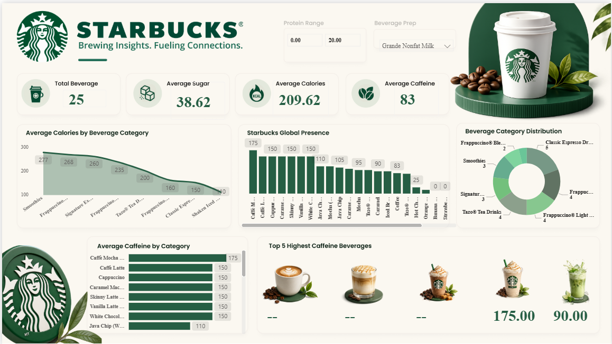

# ☕ Starbucks Power BI Dashboard

An interactive **Starbucks Beverage Insights Dashboard** built with Microsoft Power BI to explore beverage nutrition, caffeine levels, calories, sugar content, and category-wise comparisons.

> **Tagline:** *Brewing Insights. Fueling Connections.*

This project demonstrates data cleaning, data modeling, DAX measures, KPI cards, slicers, and interactive visualization through a Starbucks-themed dashboard.

## 📊 Dashboard Preview



## 🎯 Project Objectives

- Analyze nutritional information across Starbucks beverages.
- Compare average calories, sugar, and caffeine by beverage category.
- Understand how beverages are distributed across categories.
- Identify the beverages with the highest caffeine content.
- Let users filter the data by **protein range** and **beverage preparation** (milk type/size).
- Present key findings in an interactive, easy-to-understand dashboard.

## 🛠️ Tools & Technologies

- **Microsoft Power BI Desktop**: dashboard development and visualization
- **Power Query Editor**: data cleaning and transformation
- **DAX (Data Analysis Expressions)**: calculations and KPI measures
- **CSV / Excel**: data import and preparation

## 📈 Key Performance Indicators

Values below are from the current dashboard view (with the filters shown in the screenshot).

| KPI | Value | Description |
|---|---|---|
| Total Beverages | **25** | Number of beverage records analyzed |
| Average Sugar | **38.62** | Mean sugar content across the filtered records |
| Average Calories | **209.62** | Mean calorie content across the filtered records |
| Average Caffeine | **83** | Mean caffeine content across the filtered records |

*Confirm metric units (e.g., grams for sugar, mg for caffeine) against the original dataset.*

## 🎛️ Interactive Filters (Slicers)

| Slicer | Purpose | Example Selection |
|---|---|---|
| **Protein Range** | Filters beverages by protein content | 0.00 – 20.00 |
| **Beverage Prep** | Filters by preparation type (milk/size) | Grande Nonfat Milk |

All KPI cards and charts update dynamically when a slicer changes.

## 📉 Dashboard Visualizations

### 1. Average Calories by Beverage Category
An area chart comparing average calories across categories. **Smoothies (277)**, **Frappuccino® categories (268, 235, 160)**, and **Signature Espressos (260)** sit at the top, while **Classic Espresso Drinks (150)** and **Shaken Iced Beverages** are at the lower end.

### 2. Starbucks Global Presence
A bar chart ranking individual beverages by the plotted metric (highest bar: 175, e.g., Caffè Mocha; lowest bars at 0). A horizontal scroll bar lets users explore all items.

> ⚠️ The values in this chart match the caffeine figures in the other visuals, so confirm the chart's title and measure match your intended data (e.g., rename it "Caffeine by Beverage" or connect real store-presence data).

### 3. Beverage Category Distribution
A donut chart showing how the 25 beverages split across categories:

| Category | Count |
|---|---|
| Classic Espresso Drinks | 5 |
| Frappuccino® (variant) | 4 |
| Frappuccino® Light | 4 |
| Tazo® Tea Drinks | 4 |
| Smoothies | 3 |
| Signature Espresso Drinks | 3 |
| Frappuccino® Blended | 2 |

### 4. Average Caffeine by Category
A horizontal bar chart comparing caffeine levels. **Caffè Mocha leads with 175**, followed by Caffè Latte, Cappuccino, Caramel Macchiato, Skinny Latte, Vanilla Latte, and White Chocolate Mocha at **150** each, and Java Chip at **110**.

### 5. Top 5 Highest Caffeine Beverages
A visual card row with beverage images and their caffeine values (e.g., **175.00** and **90.00** in the current view). Some slots display `--` when no value is returned under the active filters.

## 🔍 Key Insights

- The dataset in this view contains **25 beverages**, averaging **~210 calories**, **~39 sugar**, and **83 caffeine**.
- **Smoothies and Frappuccino® drinks** are the most calorie-dense categories.
- **Caffè Mocha** has the highest caffeine value (175); most espresso-based drinks cluster at 150.
- **Classic Espresso Drinks** is the largest category (5 of 25 beverages).

## 🧹 Data Preparation

1. Import the source dataset(s) into Power BI.
2. Inspect column names, data types, missing values, and duplicates.
3. Clean and transform the data using Power Query (fix types, handle nulls, rename columns).
4. Create relationships between tables where required.
5. Develop DAX measures for KPI calculations.
6. Validate calculations against the source data.
7. Design and format the dashboard visuals, slicers, and theme.

## 🧮 Example DAX Measures

Adapt table and column names to match your dataset.

**Total Beverages**

```dax
Total Beverages =
COUNTROWS('Beverages')
```

**Average Calories**

```dax
Average Calories =
AVERAGE('Beverages'[Calories])
```

**Average Sugar**

```dax
Average Sugar =
AVERAGE('Beverages'[Sugar])
```

**Average Caffeine**

```dax
Average Caffeine =
AVERAGE('Beverages'[Caffeine])
```

**Max Caffeine (for Top 5 cards)**

```dax
Max Caffeine =
MAX('Beverages'[Caffeine])
```

These examples assume a table named `Beverages` with the corresponding columns. Update names and units to match your actual data model.

## 📂 Repository Structure

```text
starbucks-power-bi-dashboard/
├── README.md
├── Dashboard/
│   └── Starbucks Power BI Dashboard.pbix
├── Dataset/
│   └── starbucks_beverages.csv
|   └── directory.csv
├── Images/
│   └── Starbucks Power BI Dashboard.png
```

Include only the files and folders you actually create.

## 🚀 How to Run the Project

1. Install **Microsoft Power BI Desktop**.
2. Clone or download this repository.
3. Open `dashboard/Starbucks_Dashboard.pbix`.
4. If prompted, update the data source path to point to your local `data/` folder.
5. Click **Refresh** to load the data.
6. Use the **Protein Range** and **Beverage Prep** slicers to explore the visuals.

## ⚠️ Known Limitations

- The **Top 5 Highest Caffeine Beverages** section shows `--` for some slots under the current filters.
- The **Starbucks Global Presence** chart should be verified against the intended metric and dataset.
- Category labels are truncated in some charts; widen the visuals or enable tooltips for full names.

## 🎓 Skills Demonstrated

- Data cleaning and transformation
- Exploratory data analysis
- Data modeling
- DAX calculations
- KPI development
- Interactive dashboard design
- Data storytelling and visualization

## 👤 Author

**Your Name**

- GitHub: [Your GitHub Profile](https://github.com/sanikadshinde264)
- LinkedIn: [Your LinkedIn Profile](https://www.linkedin.com/sanikadshinde264)

## 📄 License

This project is licensed under the MIT License. See the `LICENSE` file for details.

*This is an educational/portfolio project and is not affiliated with or endorsed by Starbucks. Starbucks name and logo are trademarks of Starbucks Corporation.*
